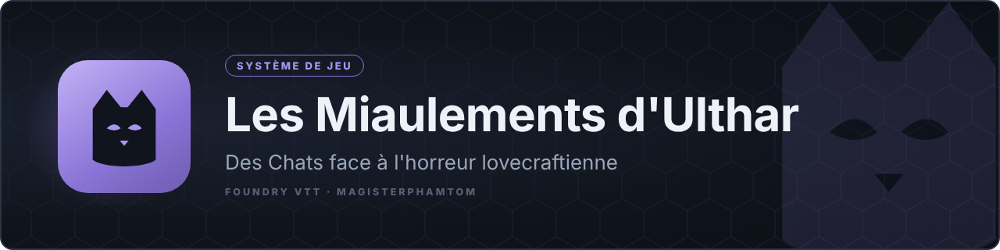

# Les Miaulements d'Ulthar — système Foundry VTT

Système de jeu non officiel pour **Foundry VTT v13/v14** (vérifié sur 14.368) adapté du jeu de rôle
*Les Miaulements d'Ulthar*, où l'on incarne des Chats d'Ulthar face à l'horreur lovecraftienne.

## Crédits et autorisation
- Jeu de rôle, textes, univers et illustrations : © Xavier Laporte (**Xaviiiier**) — [xaviiiier.com](https://www.xaviiiier.com). Tous droits réservés.
- Ce système est publié **avec l'autorisation de l'auteur**. Achetez le jeu et soutenez-le : le livre des règles reste nécessaire pour jouer.
- Code du système : magisterphamtom.

## Installation
Dans Foundry : *Systèmes de jeu* › *Installer un système* › coller le lien manifeste :

`https://github.com/magisterphamtom/miaulements-ulthar/releases/latest/download/system.json`

## Contenu
- Fiche de Chat fidèle à la fiche papier, assistant de création, jets D100, Folie, progression, combat automatisé, pouvoirs et bulle onirique.
- Compendiums : pouvoirs, tables, bestiaire (29 adversaires), 7 prétirés, scénarios, macros du Gardien.
- Deux wikis qui s'ouvrent tout seuls : joueurs et Gardien.

## État
Voir [ETAT.md](ETAT.md). Version 0.3.0, pas encore testée dans Foundry.
