<p align="center">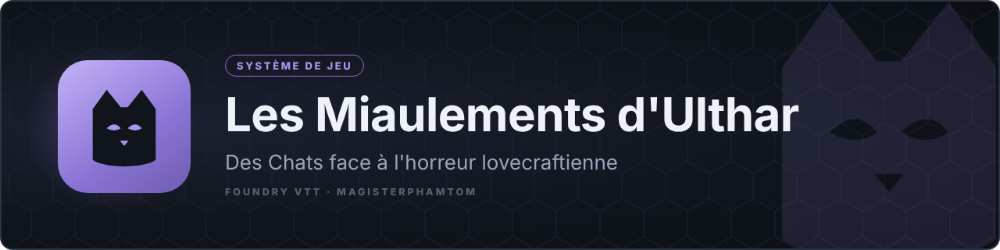</p>

<h1 align="center">Les Miaulements d'Ulthar</h1>

<p align="center">
  <b>Découvrez le jeu et tout ce que contient son système pour Foundry Virtual Tabletop.</b><br>
  Foundry VTT v14 (vérifié sur 14.368) · version 0.20.4 · en français · gratuit
</p>

<p align="center">
  <a href="#vous-êtes-un-chat-dulthar">Le jeu</a> ·
  <a href="#installer-le-système-en-trois-minutes">Installer</a> ·
  <a href="#lécran-daccueil--on-joue-tout-de-suite">L'écran d'accueil</a> ·
  <a href="#créer-son-chat-en-quelques-clics">Créer son Chat</a> ·
  <a href="#une-fiche-fidèle-à-la-fiche-papier">La fiche</a> ·
  <a href="#les-règles-soccupent-delles-mêmes">Pendant la partie</a> ·
  <a href="#mener-sans-rien-préparer">Pour le Gardien</a> ·
  <a href="#le-bestiaire-prêt-à-poser">Bestiaire</a> ·
  <a href="#tout-ce-que-vous-trouverez-en-important-le-système">Dans la boîte</a> ·
  <a href="#les-petits-plus">À la table</a> ·
  <a href="#questions-fréquentes">Questions</a> ·
  <a href="#crédits">Crédits</a> ·
  <a href="#in-english">In English</a>
</p>

---

Vous avez entendu parler des **Miaulements d'Ulthar** et vous voulez savoir à quoi ressemble une partie en ligne ? Cette page présente le jeu, puis tout ce que vous trouverez en installant son **système pour Foundry Virtual Tabletop** : l'écran d'accueil, la création de votre Chat, la fiche, les règles automatisées, le contenu prêt à jouer et les outils du Gardien. Les images viennent du système tel qu'il tourne aujourd'hui.

L'idée : installer, inviter ses amis, et jouer le soir même, sans rien préparer.

> Système non officiel, publié **avec l'accord de l'auteur**, Xavier Laporte. Le livre des règles reste nécessaire pour jouer : achetez le jeu et soutenez son auteur sur [xaviiiier.com](https://www.xaviiiier.com).

## Vous êtes un Chat d'Ulthar

**Les Miaulements d'Ulthar** est un jeu de rôle de **Xavier Laporte** (Xaviiiier), inspiré de Lovecraft. Les joueurs n'incarnent pas des investigateurs humains, mais des **Chats** : de petits félins malins, curieux et un peu magiques, qui vont et viennent entre deux mondes.

<table>
<tr>
<td width="50%" valign="top">

- **Le monde éveillé** : Arkham et la Nouvelle-Angleterre des années 20, ses ruelles, son asile, ses mafieux et ses cultistes.
- **La Contrée du Rêve** : Ulthar, la cité où nul ne peut tuer un chat, et les terres oniriques qui l'entourent.
- Des humains en danger qui ne comprennent rien à ce qui les menace… et des Chats qui, eux, comprennent.

</td>
<td width="50%" valign="top">

- **Dix races** de Chats, du gouttière au Sphynx, chacune avec ses forces et son pouvoir.
- **Des pouvoirs** innés, de race et temporaires, payés en points de Magie.
- **La Folie** qui guette, sous forme de cartes à piocher.
- **Neuf vies… ou presque** : à 0 PV, Bast ressuscite le Chat, qui perd une vie.

</td>
</tr>
</table>

Trois façons de jouer : **Pulp** (héroïque et généreux), **Serious Cat** (plus dur, plus sombre) et la **co-investigation**, où des Chats enquêtent aux côtés d'humains.

<p align="center">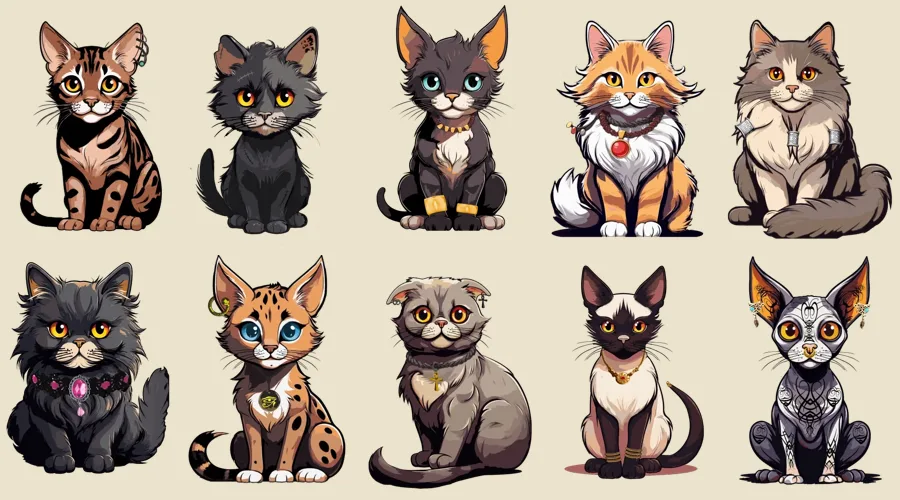<br><sub>Les dix races, telles que les dessine le livre de règles.</sub></p>

## Installer le système en trois minutes

| Étape | Ce qu'on fait |
|---|---|
| **1. Installer** | Dans Foundry, onglet **Systèmes de jeu › Installer un système**, collez le lien du manifeste ci-dessous en bas de la fenêtre, puis **Installer**. |
| **2. Créer un monde** | Onglet **Mondes › Créer un monde**, choisissez le système « Les Miaulements d'Ulthar ». |
| **3. Lancer** | Entrez dans le monde en tant que Gardien : l'écran d'accueil s'ouvre tout seul. |
| **4. Préparer** | Sur l'écran d'accueil, la coupure du Gardien importe en un clic les compendiums voulus (wikis, scénarios, prétirés, bestiaire…). |
| **5. Inviter** | Créez un compte par joueur dans la gestion des utilisateurs du monde ; chacun créera son Chat en arrivant. |

Lien du manifeste :

```
https://github.com/magisterphamtom/miaulements-ulthar/releases/latest/download/system.json
```

Les mises à jour arrivent ensuite par le bouton « Mettre à jour » de Foundry.

## L'écran d'accueil : on joue tout de suite

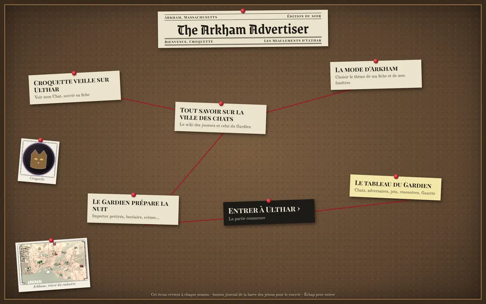

Chaque joueur arrive sur un **tableau d'enquête** en liège : des coupures de l'Arkham Advertiser punaisées, reliées par un fil rouge. Chaque coupure ouvre une page où l'on agit directement, comme l'écran titre d'un jeu vidéo : pas de menu à chercher.

- **Un nouveau Chat arrive à Ulthar** : on crée son personnage sans quitter l'écran.
- **Mon Chat** : son portrait, ses valeurs, et un bouton pour ouvrir sa fiche.
- **Le wiki** : les règles et l'univers, lisibles sur place.
- **La mode d'Arkham** : on choisit l'habillage de sa fiche.
- **Pour le Gardien** : importer les compendiums et ouvrir son tableau de bord.
- **Entrer à Ulthar** : l'écran s'efface ; un bouton le rouvre à tout moment.

Des **visites guidées**, une pour les joueurs et une pour le Gardien, présentent l'interface pas à pas (Paramètres › Visites guidées).

## Créer son Chat en quelques clics

<table>
<tr>
<td width="50%">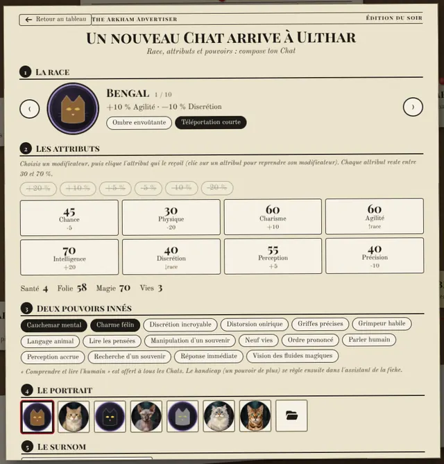</td>
<td valign="top">

La création suit les règles du livre, mais l'écran fait les calculs à votre place :

- Choisissez votre **race** dans un carrousel illustré par le livre : l'illustration devient le portrait de votre Chat.
- Posez vos **six modificateurs** d'un clic : la Santé, la Folie et la Magie se calculent en direct.
- Choisissez vos **pouvoirs** (deux innés, un de race ; « Comprendre et lire l'humain » est offert).
- Un **surnom**, un portrait… « Ce Chat est prêt ! »

Pressé ? Les **sept Chats prétirés** du livre attendent dans leur compendium, prêts à jouer.

</td>
</tr>
</table>

## Une fiche fidèle à la fiche papier

<table>
<tr>
<td width="50%"></td>
<td valign="top">

La fiche de Chat reprend **la fiche de personnage officielle** du livre. Un clic sur un attribut lance le jet ; les cases d'échec se cochent toutes seules et font progresser votre Chat.

- Onglets en marque-pages **oreilles de chat** : Fiche, Création, Pouvoirs, Folie et progression, Notes.
- Un **journal du Chat** qui s'écrit tout seul : critiques, vies perdues, pouvoirs, progrès.
- Infobulles sur chaque attribut, écriture manuscrite au choix, zoom à la molette.

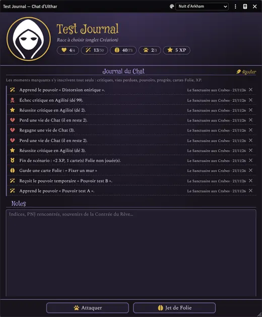

</td>
</tr>
</table>

**Quatre habillages, au choix de chaque joueur** : Nuit d'Arkham, Grimoire d'Ulthar, Contrée du Rêve, Journal d'Arkham 1921.


## Les règles s'occupent d'elles-mêmes

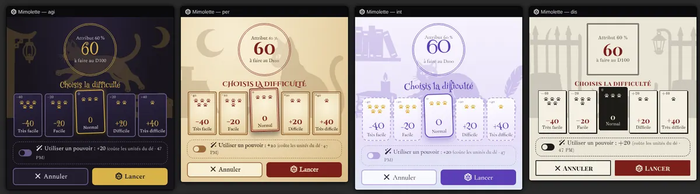

Chaque jet s'ouvre sur une petite fenêtre : on choisit la **difficulté** parmi cinq cartes, on peut ajouter un **pouvoir**, et le résultat arrive dans la messagerie, habillé selon le thème de chacun. Les points de Magie dépensés, les cases d'échec, les critiques : tout est compté.


<table>
<tr>
<td width="50%" valign="top">

- **Folie** : un jet raté fait piocher une vraie carte Folie, que le Chat garde en main ou joue tout de suite.
- **Combat** : attaques, dégâts appliqués en un clic, vies de Chat et résurrection par Bast.
- **Bulle onirique** : la magie du rêve guidée étape par étape, avec un voile de rêve sur la scène.
- **Fin de scénario** : XP, Santé et Magie restaurées, Folie réglée, en un bouton.

</td>
<td width="50%"><br><sub>Le voile de rêve pendant une bulle onirique.</sub></td>
</tr>
</table>

## Mener sans rien préparer

<table>
<tr>
<td width="55%"></td>
<td valign="top">

Le **tableau du Gardien** réunit en une fenêtre l'état de tous les Chats, les adversaires présents sur la scène, les derniers jets et tous les outils.

- **Générateur de rencontres** : selon le lieu et le danger, un adversaire du bestiaire, une situation et une complication, avec les jetons posés cachés.
- **Paquet de cartes Folie** et la main de chaque Chat.
- **Suivi de campagne** : les fiches de suivi du livre des scénarios, remplies en jeu.
- **Wiki du Gardien** et **écran du MJ** en panneaux, tables à lancer comprises.

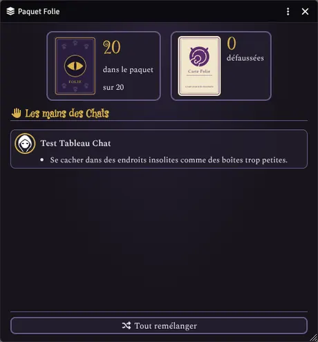

</td>
</tr>
</table>

**La Gazette** : pour ouvrir ou clore un scénario, le Gardien publie une une de journal qui s'affiche chez toute la table, **The Arkham Advertiser** en ville, **Le Miaulement d'Ulthar** dans la Contrée du Rêve.

<table>
<tr>
<td width="50%"></td>
<td width="50%">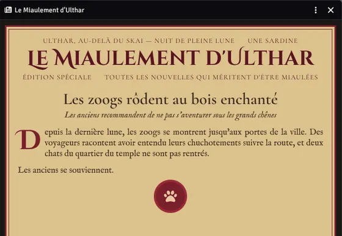</td>
</tr>
</table>

## Le bestiaire, prêt à poser

<table>
<tr>
<td width="45%">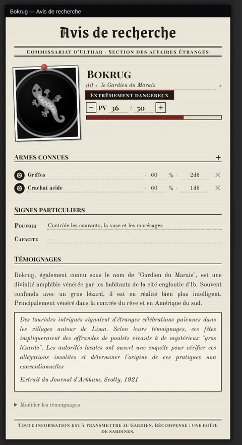</td>
<td valign="top">

**29 adversaires**, du rat de ruelle aux Grands Anciens, avec leurs attaques, leurs points de vie, leur pouvoir et leur description. Chacun a son jeton illustré par le bestiaire du livre, et sa fiche prend la forme d'un avis de recherche du commissariat d'Ulthar.

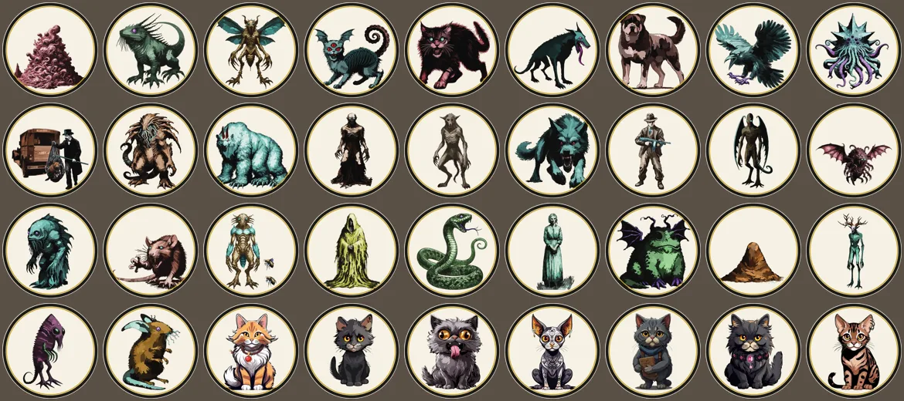

</td>
</tr>
</table>

## Tout ce que vous trouverez en important le système

| Compendium | Contenu |
|---|---|
| Wiki des joueurs | L'univers, la création, les règles, les pouvoirs et les races, en pages reliées |
| Wiki du Gardien | Guide du maître de jeu, univers de Lovecraft, scénario d'initiation, écran du MJ, bestiaire |
| Scénarios | Cinq scénarios, la campagne « Les Clefs Interdites », Sommilius et les aides de jeu (dont 4 cartes) |
| Prétirés | 7 Chats prêts à jouer |
| Pouvoirs | 87 pouvoirs innés, de race et temporaires |
| Bestiaire | 29 adversaires avec leur jeton illustré |
| Tables | Cartes Folie, événements en ville, réactions humaines et animales, pouvoirs temporaires, surnoms |
| Scènes | Accueil et 4 cartes : Massachusetts, Arkham, Contrée du Rêve, Ulthar |
| Macros | 11 outils : début et fin d'aventure, Folie du groupe, rencontres, paquet Folie, Gazette, tables… |

<p align="center">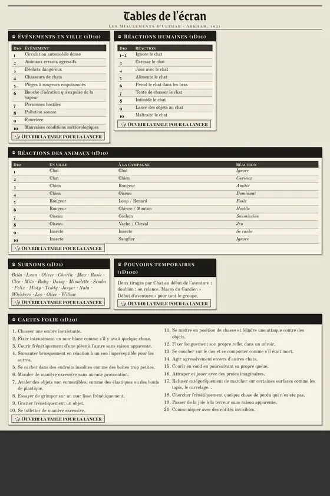<br><sub>L'écran du MJ et ses tables à lancer, dans le wiki du Gardien.</sub></p>

## Les petits plus

<table>
<tr>
<td align="center">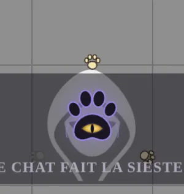<br><sub>Les vies de Chat en couronne de pattes autour du jeton.</sub></td>
<td align="center"><br><sub>Réussite critique : coup de patte doré et onde de choc.</sub></td>
<td align="center"><br><sub>Échec critique : griffures et bord d'écran rouge.</sub></td>
</tr>
</table>

<table>
<tr>
<td width="60%" valign="top">

- **Critiques spectaculaires** : un coup de patte tamponne l'écran et la scène tremble.
- **Vision féline** : un voile doré sur la scène, propre à chaque joueur.
- **Les Chats** : la Santé, la Magie, la Folie et les vies de chaque Chat connecté, d'un coup d'œil.
- Pause « Le chat fait la sieste » quand le Gardien met le jeu en pause.
- Chaque effet se désactive dans les réglages, pour les machines modestes ou les tables sobres.

</td>
<td align="center">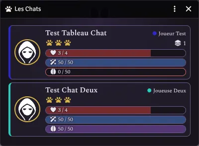</td>
</tr>
</table>

## Questions fréquentes

| Question | Réponse |
|---|---|
| Quelle version de Foundry ? | Foundry VTT version 14. |
| C'est payant ? | Non, le système est gratuit. Il faut seulement une licence Foundry pour le Gardien. |
| En quelle langue ? | En français. |
| Faut-il les livres ? | Oui : le livre des règles reste nécessaire pour jouer. Les wikis et les compendiums mettent son contenu en jeu, mais ne le remplacent pas. Achetez le jeu sur [xaviiiier.com](https://www.xaviiiier.com) et soutenez son auteur. |
| Un joueur peut-il créer son Chat seul ? | Oui, depuis l'écran d'accueil. Si son compte n'a pas le droit de créer des acteurs, le Gardien doit être connecté : son Foundry crée le Chat à sa place. |
| Mon ordinateur est modeste | Aucune animation ne tourne en boucle, et chaque effet visuel se désactive. |
| Un problème, une idée ? | L'onglet [Issues](https://github.com/magisterphamtom/miaulements-ulthar/issues) du dépôt est fait pour ça. |

## Crédits

- **Jeu de rôle, règles, textes, univers, illustrations et fiche de personnage officielle** : © Xavier Laporte (**Xaviiiier**), [xaviiiier.com](https://www.xaviiiier.com). Tous droits réservés. Ce système est publié **avec l'accord de l'auteur**, qui autorise aussi l'usage de ses illustrations (races, bestiaire, Chats du livre des scénarios).
- **Système Foundry** : magisterphamtom (conception, tests, intégration).
- **Fabrication** : le code, une partie des textes ajoutés (aides, libellés, situations de rencontre, unes de la Gazette) et certaines images (image d'accueil, chats en ombre chinoise des fenêtres, cartes des lieux) ont été réalisés avec l'aide de l'intelligence artificielle (Claude, d'Anthropic), relus et testés par magisterphamtom. Les textes des wikis et des scénarios reprennent ceux des livres de Xavier Laporte, et les portraits et jetons ses illustrations.
- **Polices** : sous licence SIL Open Font License (voir `assets/fonts/LICENCES-OFL.txt`).

Pour suivre l'avancement : [ETAT.md](ETAT.md).

---

## In English

**Les Miaulements d'Ulthar** is a French tabletop RPG by Xavier Laporte (Xaviiiier), inspired by Lovecraft: players are the Cats of Ulthar, travelling between 1920s Arkham and the Dreamlands. This is an unofficial, free Foundry VTT v14 game system, published with the author's permission; the rulebook is still needed to play ([xaviiiier.com](https://www.xaviiiier.com)). Everything is in French: a video-game-like start screen at each session (investigation board with a Cat creator illustrated by the book's art, the wiki and theme choice), a character sheet based on the official one, automated D100 rolls, Madness with a real card deck, combat and Cat lives, dream bubbles, two wikis, the illustrated bestiary, the scenarios and a set of Game Master tools. Install it with the manifest URL above. Parts of the code, added texts and some images were made with the help of AI.
