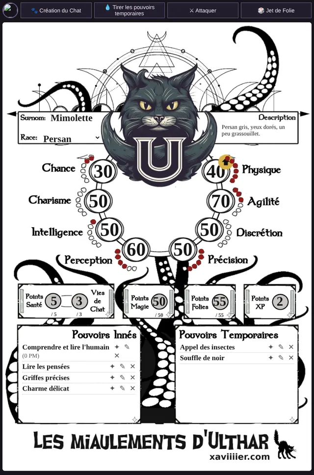
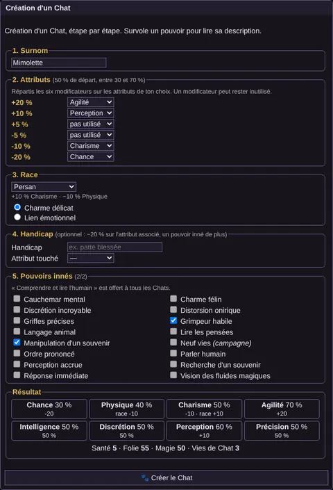
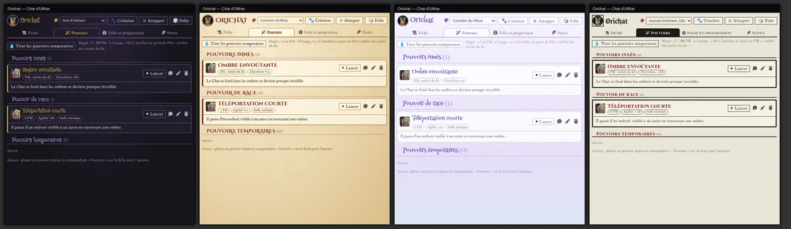
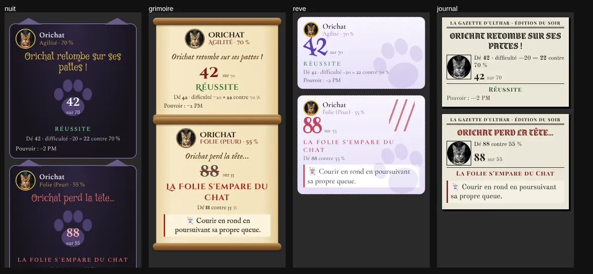
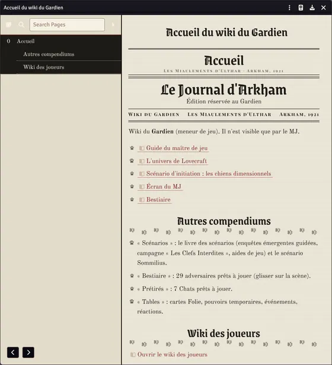
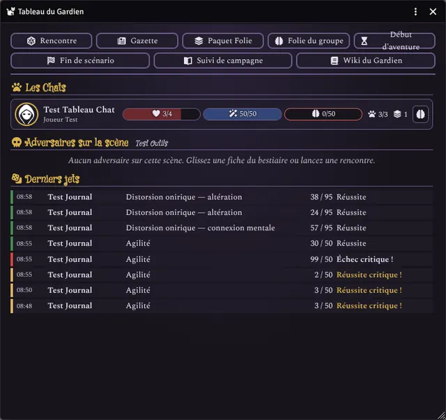
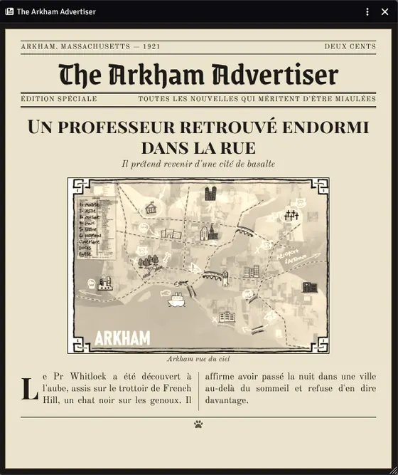
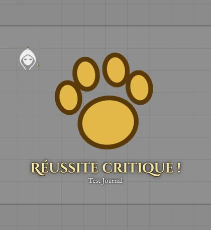
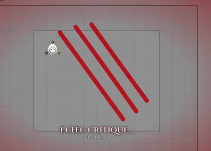
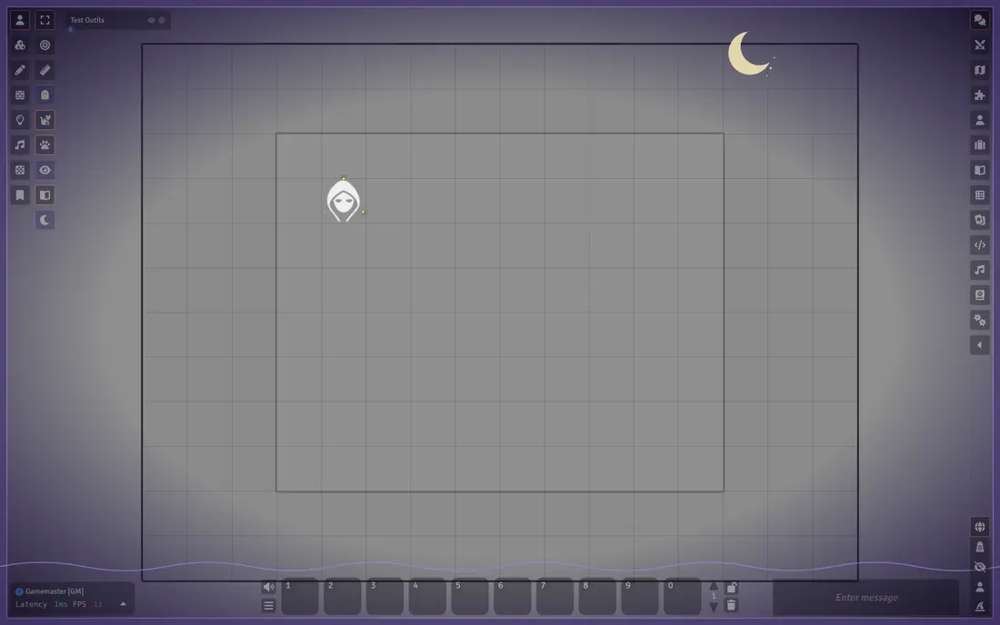

<p align="center"></p>

<h1 align="center">Les Miaulements d'Ulthar — système Foundry VTT</h1>

<p align="center">
  <b>Incarnez les Chats d'Ulthar face à l'horreur lovecraftienne, sur Foundry Virtual Tabletop.</b><br>
  Foundry VTT v14 (vérifié sur 14.368) · version 0.19.0 · en français
</p>

<p align="center">
  <a href="#installation">Installation</a> ·
  <a href="#la-fiche-de-chat">La fiche</a> ·
  <a href="#les-règles-automatisées">Les règles</a> ·
  <a href="#les-wikis-et-le-contenu">Wikis et contenu</a> ·
  <a href="#les-outils-du-gardien">Outils du Gardien</a> ·
  <a href="#à-la-table">À la table</a> ·
  <a href="#crédits">Crédits</a> ·
  <a href="#in-english">In English</a>
</p>

---

Système de jeu non officiel pour le jeu de rôle **Les Miaulements d'Ulthar** de Xavier Laporte (Xaviiiier), publié **avec l'accord de l'auteur**. Une table peut y jouer en ligne sans rien préparer : la fiche de Chat, la création, les jets, la Folie, le combat, les pouvoirs, les deux wikis, le bestiaire, les scénarios et les outils du Gardien sont prêts.

> Le livre des règles reste nécessaire pour jouer : achetez le jeu et soutenez son auteur sur [xaviiiier.com](https://www.xaviiiier.com).

## Installation

Dans Foundry : **Systèmes de jeu › Installer un système**, puis collez ce lien dans le champ « URL du manifeste » :

```
https://github.com/magisterphamtom/miaulements-ulthar/releases/latest/download/system.json
```

Créez ensuite un monde avec le système « Les Miaulements d'Ulthar ». Au premier lancement, chaque joueur voit s'ouvrir le wiki des joueurs et le Gardien le wiki du Gardien.

## La fiche de Chat

<table>
<tr>
<td width="50%"></td>
<td>

La fiche reprend **la fiche de personnage officielle** du livre : les champs sont posés sur l'image.

- Les huit attributs sont des cercles cliquables : un clic lance le jet.
- Les cases d'échec se cochent toutes seules ; Santé, Magie, Folie, vies de Chat et XP sont calculées.
- Onglets en marque-pages **oreilles de chat** le long de la fiche : Fiche, Création, Pouvoirs, Folie et progression, Notes.
- Pastilles cliquables, infobulles, écriture manuscrite au choix, zoom à la molette.
- Un **assistant de création** guide pas à pas, et les **7 Chats prétirés** du livre sont prêts à jouer.



</td>
</tr>
</table>

**Quatre thèmes au choix de chaque joueur** : Nuit d'Arkham, Grimoire d'Ulthar, Contrée du Rêve, Journal d'Arkham 1921.



## Les règles automatisées


- **Jets** : la difficulté se choisit en piochant une carte (de −40 à +40), avec ou sans pouvoir (−20 au dé, les unités du dé en points de Magie).
- **Résultats** dans la messagerie, sur des cartes habillées selon le thème de chaque joueur.
- **Seuils de critique** selon le mode de jeu : Pulp, Serious Cat ou co-investigation.
- **Progression** : toutes les cases d'échec cochées, l'attribut monte de 1D10.
- **Folie** : un jet raté pioche une carte dans le **paquet Folie** (un vrai paquet Foundry, sans doublon jusqu'au remélange) ; le Chat peut la garder en main.
- **Combat** : attaques des Chats et des adversaires, dégâts aux cibles en un clic, vies de Chat et résurrection par Bast.
- **Bulle onirique** guidée pas à pas : connexion mentale, objectif, scène, altérations jusqu'à deux réussites ou deux échecs.
- **Fin de scénario** : XP, Santé, Magie et vies remises, perte de Folie pour chaque carte non jouée.



## Les wikis et le contenu

<table>
<tr>
<td width="50%"></td>
<td>

**Deux wikis qui s'ouvrent tout seuls** au lancement, au thème « Journal d'Arkham, 1921 » : le wiki des joueurs (univers, création, règles, pouvoirs, races) et le wiki du Gardien (guide du maître de jeu, univers de Lovecraft, scénario d'initiation, écran du MJ, bestiaire).

| Compendium | Contenu |
|---|---|
| Pouvoirs | 87 pouvoirs innés, de race et temporaires |
| Prétirés | 7 Chats prêts à jouer |
| Bestiaire | 29 adversaires |
| Scénarios | les cinq scénarios du livre, la campagne « Les Clefs Interdites », Sommilius, les aides de jeu |
| Tables | cartes Folie, événements en ville, réactions humaines et animales, pouvoirs temporaires, surnoms |
| Scènes | accueil et 4 cartes : Massachusetts, Arkham, Contrée du Rêve, Ulthar |
| Macros | 11 outils du Gardien |

</td>
</tr>
</table>

<table>
<tr>
<td width="50%"><br><sub>Les adversaires ont une fiche en avis de recherche.</sub></td>
<td width="50%"><br><sub>L'écran du MJ et ses tables à lancer.</sub></td>
</tr>
</table>

## Les outils du Gardien

<table>
<tr>
<td width="55%"></td>
<td>

- **Tableau du Gardien** : l'état de tous les Chats, les adversaires de la scène (PV, attaques), les derniers jets et tous les outils, dans une seule fenêtre.
- **Générateur de rencontres** : selon le lieu et le danger, un adversaire du bestiaire, une situation et une complication ; les jetons sont posés cachés.
- **Paquet de cartes Folie** : les cartes restantes, la défausse et la main de chaque Chat.
- **Suivi de campagne** : les fiches de suivi du livre des scénarios, remplies en jeu.

</td>
</tr>
</table>

**La Gazette** : une une de journal à montrer à toute la table pour ouvrir ou clore un scénario, en journal d'Arkham des années 20 ou en parchemin d'Ulthar selon le lieu.

<table>
<tr>
<td width="50%"></td>
<td width="50%"></td>
</tr>
</table>

## À la table

<table>
<tr>
<td align="center"><br><sub>Les vies de Chat en couronne de pattes autour du jeton.</sub></td>
<td align="center"><br><sub>Réussite critique : un coup de patte doré.</sub></td>
<td align="center"><br><sub>Échec critique : trois griffures.</sub></td>
</tr>
</table>

- **Voile de rêve** : pendant une bulle onirique, les bords de la scène passent en nuit, avec une lune, chez toute la table.
- **Journal du Chat** : les moments marquants s'inscrivent tout seuls dans l'onglet Notes (critiques, vies perdues, pouvoirs, progrès, cartes Folie, XP).
- **Vision féline**, **suivi des Chats**, image d'accueil et pause « Le chat fait la sieste ».
- Chaque effet visuel peut être désactivé par le joueur ; tout est pensé pour peser le moins possible sur l'ordinateur.



## Crédits

- **Jeu de rôle, règles, textes, univers et fiche de personnage officielle** : © Xavier Laporte (**Xaviiiier**), [xaviiiier.com](https://www.xaviiiier.com). Tous droits réservés. Ce système est publié **avec l'accord de l'auteur**.
- **Système Foundry** : magisterphamtom (conception, tests, intégration).
- **Fabrication** : le code, une partie des textes ajoutés (aides, libellés, situations de rencontre, unes de la Gazette) et certaines images (accueil, chats en ombre chinoise des fenêtres, cartes des lieux, portraits de quatre Chats prétirés) ont été réalisés avec l'aide de l'intelligence artificielle (Claude, d'Anthropic), relus et testés par magisterphamtom. Les textes des wikis et des scénarios reprennent ceux des livres de Xavier Laporte.
- **Polices** : sous licence SIL Open Font License (voir `assets/fonts/LICENCES-OFL.txt`).

Pour suivre l'avancement : [ETAT.md](ETAT.md). Pour signaler un problème : l'onglet [Issues](https://github.com/magisterphamtom/miaulements-ulthar/issues).

---

## In English

**Les Miaulements d'Ulthar** is an unofficial Foundry VTT v14 game system for the French tabletop RPG by Xavier Laporte (Xaviiiier), where players are the Cats of Ulthar facing Lovecraftian horror. It is published with the author's permission. Everything is in French: a character sheet based on the official one, a creation wizard, automated D100 rolls, Madness with a real card deck, combat and Cat lives, dream bubbles, two auto-opening wikis, the bestiary, the scenarios and a set of Game Master tools. Install it with the manifest URL above. Parts of the code, added texts and some images were made with the help of AI.
